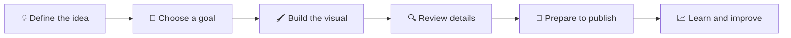

<div align="center">


<br />


<br /><br />

<a href="https://share.google/HV6s8JMweVomKQUcV"></a>
&nbsp;
<a href="https://share.google/HV6s8JMweVomKQUcV"></a>
&nbsp;
<a href="https://share.google/HV6s8JMweVomKQUcV"></a>

<br /><br />


</div>


---

## ✦ Content that feels like your brand

**Instagram Post Creator** is a creative project centered on planning and designing compelling Instagram visuals. Whether you're building a personal brand, preparing a product launch, announcing an event, or creating a polished carousel, this guide helps you approach every post with clearer goals and a more consistent visual direction.

Strong social content isn't only about choosing pretty colors. The best posts make a promise, deliver useful information, and give viewers a reason to save, share, or respond. A good creation workflow supports all three: **message, design, and delivery**.

This README is a practical companion to the project: it covers visual planning, layout choices, carousel storytelling, accessibility, export preparation, and repeatable content-production habits. Features and setup details may vary with the version provided through the project link.

## 🪄 Creative workflow at a glance

<div align="center">



</div>

Start with one clear idea rather than trying to fit an entire campaign into a single image. Choose the format that makes that idea easy to consume, then build a visual hierarchy that guides the reader from the hook to the supporting detail and finally to the action.

## 🧩 The creative toolkit

<!-- Single feature-card section -->
<table align="center">
  <tr>
    <td width="33%" valign="top" align="center">
      <h3>🪩 Visual Identity</h3>
      <p>Define a memorable palette, typography hierarchy, and image style that make every post recognizable.</p>
    </td>
    <td width="33%" valign="top" align="center">
      <h3>🧵 Carousel Stories</h3>
      <p>Organize a topic into short, connected slides with a compelling hook and a useful ending.</p>
    </td>
    <td width="33%" valign="top" align="center">
      <h3>🧲 Stronger Hooks</h3>
      <p>Give people a specific reason to stop scrolling: a question, outcome, comparison, or insight.</p>
    </td>
  </tr>
  <tr>
    <td width="33%" valign="top" align="center">
      <h3>🧿 Balanced Layouts</h3>
      <p>Use whitespace, alignment, readable text, and contrast to make dense information easier to scan.</p>
    </td>
    <td width="33%" valign="top" align="center">
      <h3>🗓️ Content Planning</h3>
      <p>Group ideas into recurring themes and prepare batches instead of starting from zero each day.</p>
    </td>
    <td width="33%" valign="top" align="center">
      <h3>🧪 Iterative Growth</h3>
      <p>Review the posts that earn saves, shares, replies, and meaningful engagement—and refine your approach.</p>
    </td>
  </tr>
</table>

---

## 🖼️ Choosing the right format

| Format | Best for | Design approach |
|:--|:--|:--|
| **Single-image post** | Announcements, quotes, product highlights | One message, one focal point, strong contrast |
| **Educational carousel** | Tutorials, checklists, explainers | One idea per slide; clear progression |
| **Before-and-after** | Transformations and comparisons | Consistent framing and honest context |
| **Promotional graphic** | Offers, events, launches | Clear value, date/details, and call to action |
| **Mini infographic** | Processes, statistics, quick tips | Labels, spacing, and restrained decoration |

### Recommended canvas planning

Instagram's supported image shapes and display behavior can change, so confirm current requirements before publishing. Useful design starting points include:

| Canvas | Example size | Practical use |
|:--|:--|:--|
| Square (1:1) | `1080 × 1080 px` | Versatile static posts |
| Portrait (4:5) | `1080 × 1350 px` | Tall feed graphics |
| Vertical (9:16) | `1080 × 1920 px` | Story-style creative assets |

For carousels, keep the same aspect ratio across slides and protect the edges from important text that could be cropped in previews.

## 🧠 Build a post people actually read

### 01 — Define the outcome

Write one sentence explaining what someone should know, feel, or do after viewing the post. For example: *“A first-time creator should understand three ways to make a carousel easier to read.”*

### 02 — Write the hook first

Your opening should answer the reader's silent question: **“Why should I care?”** Lead with a concrete outcome, useful problem, or intriguing comparison—not an introduction that takes three slides to get to the point.

### 03 — Construct a visual hierarchy

Use a prominent headline, smaller supporting text, and a clear reading order. Keep font sizes comfortably legible on a phone, not just on a desktop editor. Limit decorative typefaces and give important content room to breathe.

### 04 — Add personality with restraint

A recognizable brand isn't a different effect on every slide. Repeat a small design system: two or three core colors, a restrained type scale, consistent spacing, and familiar graphic accents.

### 05 — Review before publishing

Proofread the caption and slide text. Check contrast, alignment, cropping, image quality, consistency, and whether the intended message is understandable without extra context.

---

## 🧶 A seven-slide carousel blueprint

| Slide | Purpose | Example direction |
|:--:|:--|:--|
| **01** | Stop the scroll | “5 design mistakes that make posts hard to read” |
| **02** | Set context | Explain why readability affects engagement |
| **03** | Teach point one | Show a cluttered vs. simplified layout |
| **04** | Teach point two | Demonstrate stronger typography hierarchy |
| **05** | Teach point three | Explain consistency across slides |
| **06** | Summarize | Offer a compact, saveable checklist |
| **07** | Invite action | Ask a relevant question or suggest the next step |

A carousel should work as a connected story, but every individual slide still needs enough context to make sense when shared alone. Use headings that describe the takeaway rather than vague labels such as “Tip 2.”

## 🎛️ A simple design system

A useful starter system can be documented before creating the first graphic:

```yaml
brand:
  personality: "Bold, friendly, practical"
  primary_color: "#5C2E91"
  accent_color: "#EA4C89"
  background_color: "#FFF8FC"
  text_color: "#28134A"

typography:
  headline: "High contrast, short and readable"
  body: "Simple sans serif, mobile-first"

layout:
  spacing: "Consistent across the series"
  alignment: "Clear grid and safe margins"
  imagery: "One cohesive photographic or illustration style"
```

The palette above is an **example brand system**, not a statement about the project's built-in themes. Replace it with the colors that best fit your own content.

## ⚡ Efficient content production

**Batch by task, not by post.** Brainstorm several ideas in one session, write their hooks together, draft slide copy together, and then move into visual design. This reduces context switching and makes your output more consistent.

**Maintain a reusable checklist.** Even when every post has a different concept, the quality bar should stay the same: readable on mobile, visually balanced, clear in meaning, and ready for the chosen format.

**Design for accessibility.** Avoid color-only meaning, favor strong foreground/background contrast, write concise captions, and add meaningful alternative text where the platform supports it.

**Improve using real feedback.** Saves and shares can suggest that content is useful; comments and replies can reveal unanswered questions. Evaluate performance in the context of the post's goal rather than optimizing every post for the same number.

## 🛠️ Getting started

1. Open the project using one of the links at the top of this README.
2. Review the available project files, documentation, and any setup requirements provided with your version.
3. Choose a content goal and a target format (single post or carousel).
4. Prepare your copy, imagery, and preferred visual style before editing.
5. Assemble the post, check the mobile viewing experience, and export using the appropriate settings supported by your tools.
6. Review the final asset and publish it through your normal Instagram workflow.

> **Note:** The exact runtime, installation commands, export options, and supported editing features are not specified here. Check the actual project package before assuming that a particular feature is available.

## ✅ Pre-publish quality checklist

- [ ] The headline delivers a clear promise.
- [ ] All text is readable at mobile size.
- [ ] The palette and typography feel consistent.
- [ ] No important elements touch the crop-sensitive edges.
- [ ] Every carousel slide contributes something new.
- [ ] Images and graphics have appropriate usage rights.
- [ ] Spelling, dates, figures, and links are correct.
- [ ] The caption and call to action match the post's goal.

## ❔ Frequently asked questions

<details>
<summary><b>Should I choose a single post or a carousel?</b></summary>
<br />
Use a single post when one message can be understood at a glance. Choose a carousel when your idea benefits from sequential explanation, multiple examples, or a step-by-step structure.
</details>

<details>
<summary><b>How much text belongs on a slide?</b></summary>
<br />
As little as necessary to convey a meaningful point. Focus on one takeaway per slide, break longer paragraphs into short statements, and test readability on an actual phone-sized preview.
</details>

<details>
<summary><b>What makes a visual identity consistent?</b></summary>
<br />
Repeat intentional choices: color roles, typography, spacing, image treatment, and common UI-like elements such as labels or section numbers. Consistency does not require every post to look identical.
</details>

<details>
<summary><b>Can I use the same design for every platform?</b></summary>
<br />
Reusing a visual concept is efficient, but verify each platform's display proportions, safe areas, and text readability. A quick redesign is often better than an awkward crop.
</details>

<details>
<summary><b>Does this README guarantee specific app features?</b></summary>
<br />
No. This README explains the project theme and provides practical design guidance. Confirm any feature claims, installation requirements, and file formats against the actual version you obtain.
</details>

---

## 🌙 Final thoughts

A memorable Instagram presence is built from repeated, intentional choices. Start with a useful idea, make it immediately understandable, present it with care, and improve your approach after every publishing cycle. Tools support the process, but clarity and consistency are what give your work its identity.

<div align="center">

<sub>Made for creators, small brands, marketers, and anyone who wants more thoughtful visual content.</sub>

<br /><br />


</div>
